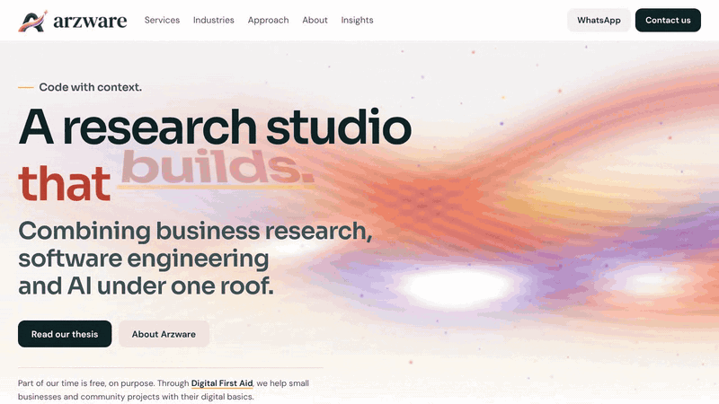

  
  
  

## Code with context.

**Arzware is a research studio that builds.** We combine business research, software engineering and AI under one roof.

We're based in Beirut and work with businesses in Lebanon, the UAE and Saudi Arabia.

## Our thesis

Most businesses get a new website, an app or an AI assistant before anyone has looked at how they take an order, answer a customer or close the day.

**So we work in the opposite order.** We read your reviews, follow your orders and look at the businesses around you. Only then do we suggest anything, and sometimes the answer is that you need less, not more.

Good technology should make a business more like itself: quicker where it was slow, calmer where it was busy, with people still in charge.

## What we do

| Service | In one line |
|---|---|
| [Business diagnosis](https://arzware.net/services/business-diagnosis/) | See what's really holding your business back, with proof, before you spend on anything. |
| [WhatsApp assistants](https://arzware.net/services/whatsapp-assistants/) | Answer the same questions once, and stop losing orders in your chat. |
| [CRM setup](https://arzware.net/services/crm-setup/) | Every lead and customer in one place, with reminders so nobody falls through. |
| [Google Workspace and AI setup](https://arzware.net/services/workspace-ai-setup/) | Professional email, shared files and AI tools your team will actually use. |
| [Websites](https://arzware.net/services/websites/) | A website that brings you customers, not just one that exists. |
| [Café and restaurant package](https://arzware.net/services/cafe-restaurant-package/) | Get found, take orders and get paid, without stitching ten tools together yourself. |
| [POS setup](https://arzware.net/services/pos-setup/) | Track orders, stock and sales without the guesswork. |
| [Monthly care plans](https://arzware.net/services/care-plans/) | Someone looking after your digital setup every month. |
| [Apps and custom software](https://arzware.net/services/apps-custom-software/) | When off-the-shelf tools aren't enough. |

→ **[All services on arzware.net](https://arzware.net/services/)**

## How we work

1. **Research first.** We study your business, your customers and your competitors before we suggest anything.
2. **Honest diagnosis.** A clear list of what's holding you back, with evidence, including things you didn't ask about.
3. **Built to fit.** Websites, WhatsApp assistants, CRM and AI, set up around how your team already works.
4. **Connected to experts.** For anything outside our work, we introduce a partner we trust, and tell you who they are.

→ **[Read the full approach](https://arzware.net/approach/)**

## How we use AI

- We name every AI provider before anything is connected, and explain what each one can see.
- If your data needs to stay with you, we can run AI locally instead.
- A person can always step in, and a person checks what matters before it goes out.

## Digital First Aid

Part of our time is free, on purpose. **[Digital First Aid](https://arzware.net/digital-first-aid/)** is our community programme: we help small businesses and community projects with their digital basics. It isn't a sales programme.

## Tell us what's slowing you down

The first call is free. Tell us what's happening and we'll suggest a next step, even if it isn't us.

- **Book a call:** [cal.com/arzware](https://cal.com/arzware)
- **WhatsApp:** [+961 81 901 378](https://wa.me/96181901378)
- **Email:** [support@arzware.net](mailto:support@arzware.net)
- **Website:** [arzware.net](https://arzware.net)

---

This repository is the source of [arzware.net](https://arzware.net): a fast, dependency-free static site deployed to Cloudflare Workers on every push to `main`. Run it locally with `npm run dev`; developer notes are in [DEVELOPMENT.md](DEVELOPMENT.md).
